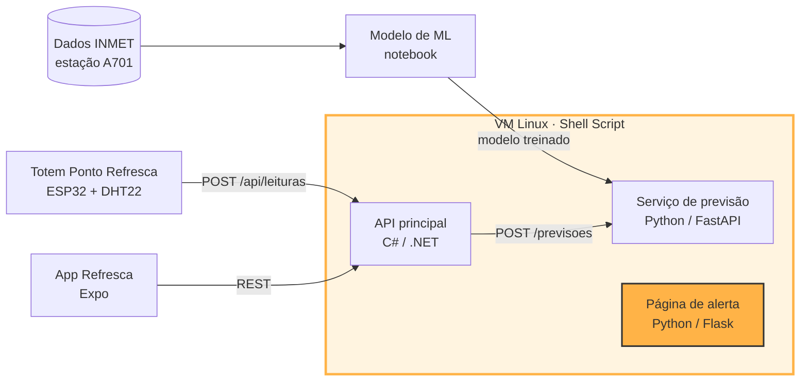

# Refresca · Infraestrutura Linux

> Parte da CitizenTech **Refresca**, da Global Solution 2026.2 (FIAP, Engenharia de Software, 3º ano de Fev).
> Alertas de calor extremo e pontos de água e sombra para trabalhadores de rua da Vila Mariana.

**Disciplina:** Operating Systems

## Ficha da CitizenTech

| Campo | Conteúdo |
| --- | --- |
| **Nome** | Refresca |
| **Cidade e bairro** | São Paulo, Vila Mariana |
| **Cidadão beneficiado** | Trabalhador de rua: ambulante, entregador, gari, vendedor de banca |
| **Problema, em uma frase** | Trabalhadores de rua da Vila Mariana passam o dia expostos ao sol sem saber quando o calor fica perigoso, nem onde encontrar sombra e água por perto. |
| **Como funciona** | 1. Totens "Ponto Refresca" em comércios parceiros medem o índice de calor na rua e mostram um alerta colorido para quem passa. 2. Um modelo treinado com dados do INMET prevê se amanhã será um dia de calor perigoso. 3. O app avisa o trabalhador na véspera, mostra os pontos com água, sombra e banheiro mais próximos e lembra das pausas para hidratação. |
| **O que cada parte faz** | Ver [Repositórios da Refresca](#repositórios-da-refresca) |
| **Link do repositório** | https://github.com/JulioZequin/citizentech-os |
| **Indicador de impacto** | Pausas de hidratação registradas no app em dias de alerta; % de alertas enviados antes do pico de calor; recall do modelo nos dias perigosos |
| **ODS conectados** | 3, 8, 10, 11 e 13 (detalhes abaixo) |

### Persona (fictícia)

Persona criada pela equipe a partir de informações públicas sobre trabalho de rua e calor. Não representa uma pessoa real nem uma entrevista realizada.

**Marcos, 34 anos, entregador de moto por aplicativo na Vila Mariana.** Passa cerca de 10 horas por dia na rua, esperando pedidos na calçada. Nos dias mais quentes sente dor de cabeça e tontura no fim da tarde. Compra água no comércio ou fica sem, quase não para porque perde corridas e tem pouco dado no celular pré-pago.

### Como os ODS são atendidos

- **ODS 3 · Saúde e bem-estar:** reduz o risco de exaustão e insolação ao antecipar dias perigosos e incentivar pausas e hidratação.
- **ODS 8 · Trabalho decente:** melhora as condições de trabalho de quem não tem posto fixo nem empregador que ofereça estrutura.
- **ODS 10 · Redução das desigualdades:** chega a quem tem pouco acesso a dados móveis, já que o totem funciona sem celular.
- **ODS 11 · Cidades sustentáveis:** transforma comércios do bairro em uma rede de pontos de apoio no espaço público.
- **ODS 13 · Ação contra a mudança do clima:** é uma ferramenta de adaptação a ondas de calor.

## Esta parte da Refresca

Esta parte é o servidor Linux onde a Refresca roda. Um único script prepara a máquina do zero (rede, DNS, usuários, dependências, aplicação e serviços), monitora CPU, memória, disco e a saúde da aplicação, registra tudo em logs de auditoria e recupera serviços que caírem. Para o Marcos, isso significa que o alerta de calor continua no ar justamente nos dias em que ele mais precisa.

Nesta entrega, a VM hospeda a **página de alerta da Refresca** (Python/Flask), que calcula o índice de calor atual da Vila Mariana e mostra os Pontos Refresca. O uso desta aplicação foi autorizado pelo professor da disciplina. Os scripts são parametrizados pelo `config.env` e podem receber a API principal e o serviço de previsão.

**Recebe dados de:** API pública Open-Meteo (temperatura e umidade atuais)
**Envia dados para:** navegador do cidadão (página de alerta) e `GET /api/status` (JSON)

## Arquitetura



### Por dentro da VM

```
Navegador (Windows)
        │  http://192.168.56.10
        ▼
┌──────────────── VM Ubuntu Server 26.04 ────────────────┐
│  UFW (firewall): libera somente 22 (SSH) e 80 (HTTP)    │
│  Nginx :80  ──proxy──►  Gunicorn :8000  ──►  App Flask  │
│                         (citizentech-app.service)       │
│  Monitor (citizentech-monitor.service)                  │
│    CPU · memória · disco · serviços · saúde da app      │
│  Logs: /var/log/citizentech/                            │
└─────────────────────────────────────────────────────────┘
```

- **Ambiente:** VM no VirtualBox (Windows), Ubuntu Server 26.04 LTS, 4 GB de RAM, 2 CPUs, 25 GB de disco
- **Rede:** Adaptador 1 em NAT (internet) e Adaptador 2 em Host-only (`enp0s8`, IP fixo `192.168.56.10`)

## Repositórios da Refresca

| Parte | Disciplina | Repositório | Responsável |
| --- | --- | --- | --- |
| Totem (Wokwi) | Physical Computing: IOT & IOB | [link do Wokwi] | [Nome] |
| API principal | C# Software Development | [link] | [Nome] |
| Serviço de previsão | SOA e Web Services | https://github.com/italocaliari/gs_soa | [Nome] |
| Modelo de ML | Inteligência Artificial & Machine Learning | [link] | [Nome] |
| App | Mobile Development & IOT | [link] | [Nome] |
| **Infraestrutura Linux** | **Operating Systems** | **https://github.com/JulioZequin/citizentech-os** | **Júlio César Ruiz Zequin** |
| Segurança e PII | Cybersecurity | entregue em ZIP | [Nome] |
| Features e testes | Testing, Compliance & QA | [link do Azure Boards] | [Nome] |

## Contratos entre as partes

| Serviço | URL local padrão | Variável de configuração |
| --- | --- | --- |
| API principal (C#) | `http://localhost:5000` | `REFRESCA_API_URL` |
| Serviço de previsão | `http://localhost:8000` | `REFRESCA_PREVISAO_URL` |

**Níveis do índice de calor** (faixas da NOAA, usadas pelo totem, pela API e pelo app):

| Nível | Índice de calor | Cor no totem |
| --- | --- | --- |
| `normal` | abaixo de 27 °C | verde |
| `atencao` | de 27 °C até abaixo de 32 °C | amarelo |
| `perigo` | a partir de 32 °C | vermelho |

### Totem → API: `POST /api/leituras`

```json
{
  "totemId": "TOT-001",
  "temperatura": 33.4,
  "umidade": 48.0,
  "indiceCalor": 35.1,
  "nivel": "perigo",
  "medidoEm": "2026-11-19T14:00:00-03:00"
}
```

### App → API

| Método | Rota | Uso no app |
| --- | --- | --- |
| `GET` | `/api/alertas/hoje` | Alerta do dia na tela inicial |
| `GET` | `/api/pontos` | Mapa de Pontos Refresca, com a última leitura de cada totem |
| `GET` | `/api/pontos/{id}` | Detalhe de um ponto |
| `POST` | `/api/pausas` | Registrar pausa de hidratação |
| `GET` | `/api/trabalhadores/{id}/pausas` | Histórico de pausas |

Exemplo de ponto em `GET /api/pontos`:

```json
{
  "id": 1,
  "nome": "Padaria Exemplo",
  "latitude": -23.5890,
  "longitude": -46.6340,
  "temAgua": true,
  "temSombra": true,
  "temBanheiro": false,
  "ultimaLeitura": { "indiceCalor": 35.1, "nivel": "perigo", "medidoEm": "2026-11-19T14:00:00-03:00" }
}
```

### API → Serviço de previsão: `POST /previsoes`

Requisição:

```json
{
  "data": "2026-11-20",
  "temperaturaMaxOntem": 31.2,
  "temperaturaMinOntem": 19.8,
  "umidadeMediaOntem": 55.0,
  "ventoMedioOntem": 2.1
}
```

Resposta:

```json
{
  "id": 42,
  "data": "2026-11-20",
  "probabilidade": 0.82,
  "perigoso": true,
  "versaoModelo": "1.0"
}
```

## Tecnologias

- Ubuntu Server 26.04 LTS no VirtualBox
- Bash (Shell Script) para todo o provisionamento
- systemd (serviços da aplicação e do monitoramento)
- Netplan (IP fixo) e systemd-resolved (DNS)
- UFW (firewall) e Nginx (proxy reverso)
- Python 3, Flask e Gunicorn (página de alerta)

## Como rodar

### Pré-requisitos

- VirtualBox com uma VM Ubuntu Server 26.04 LTS instalada, com OpenSSH Server
- Adaptador 1 em **NAT** e Adaptador 2 em **Placa de rede exclusiva de hospedeiro (Host-only)**

### Passos

```bash
# 1. Conectar na VM
ssh <usuario>@<ip-atual-da-vm>

# 2. Baixar o projeto e provisionar tudo
git clone https://github.com/JulioZequin/citizentech-os.git
cd citizentech-os
sudo bash setup.sh

# 3. Reconectar no IP fixo (a rede é aplicada no final e a sessão cai)
ssh <usuario>@192.168.56.10
systemctl is-active citizentech-app citizentech-monitor nginx
```

Resultado esperado: três linhas `active`. A página fica disponível em **http://192.168.56.10**.

O `setup.sh` executa, em ordem:
1. Fuso horário (para os logs ficarem no horário local)
2. `provision_app.sh`: aplicação
3. `setup_monitor.sh`: monitoramento
4. `provision_infra.sh`: rede (por último, porque muda o IP e encerra a sessão SSH)

Todos os scripts podem ser executados mais de uma vez sem quebrar o ambiente.

### Configuração

Todas as variáveis ficam no `config.env`. Para adaptar o ambiente, basta editá-lo.

| Variável | Exemplo | Para quê |
| --- | --- | --- |
| `SERVER_HOSTNAME` | `citizentech-server` | Nome do servidor |
| `SERVER_DOMAIN` | `citizentech.local` | Nome local resolvido no `/etc/hosts` |
| `NET_INTERFACE` | `enp0s8` | Interface Host-only |
| `STATIC_IP` / `NETMASK_CIDR` | `192.168.56.10` / `24` | IP fixo |
| `DNS_SERVERS` | `1.1.1.1,8.8.8.8` | Servidores DNS |
| `TIMEZONE` | `America/Sao_Paulo` | Fuso horário |
| `LOG_DIR` | `/var/log/citizentech` | Pasta de logs |
| `INSTALL_DIR` | `/opt/citizentech` | Pasta de instalação |
| `APP_NAME` | `Refresca` | Nome exibido na página |
| `APP_USER` | `citizentech` | Usuário de sistema da aplicação |
| `CIDADE` / `LATITUDE` / `LONGITUDE` | `Vila Mariana, São Paulo` / `-23.59` / `-46.63` | Local consultado na Open-Meteo |
| `MONITOR_INTERVAL` | `30` | Segundos entre verificações |
| `LIMITE_CPU` / `LIMITE_MEM` / `LIMITE_DISCO` | `80` | Limites de alerta (%) |
| `SERVICOS_MONITORADOS` | `citizentech-app nginx` | Serviços vigiados pelo monitor |
| `URL_SAUDE` | `http://localhost/health` | Endpoint de saúde da aplicação |

### Estrutura do repositório

```
citizentech-os/
├── setup.sh                        # Provisionamento completo (roda tudo)
├── config.env                      # Configuração central do projeto
├── app/
│   ├── app.py                      # Página de alerta da Refresca (Flask)
│   └── requirements.txt            # Dependências Python
├── nginx/
│   └── citizentech.conf            # Proxy reverso (porta 80 → 8000)
├── scripts/
│   ├── common.sh                   # Funções comuns e log de auditoria
│   ├── provision_infra.sh          # Hostname, fuso, /etc/hosts, DNS e IP fixo
│   ├── provision_app.sh            # Dependências, usuário, app, serviço, Nginx e firewall
│   ├── setup_monitor.sh            # Instala o monitor como serviço
│   ├── monitor.sh                  # Monitoramento contínuo e recuperação
│   └── teste_falha.sh              # Falha controlada para testar os logs
├── systemd/
│   ├── citizentech-app.service     # Serviço da aplicação
│   └── citizentech-monitor.service # Serviço do monitoramento
├── evidencias/                     # Capturas de tela dos testes
└── prompts.md                      # Registro de uso de IA
```

### O que cada script faz

**`provision_infra.sh`: infraestrutura**
- Define o **hostname** (`hostnamectl`) e o **fuso horário** (`timedatectl`)
- Atualiza o **/etc/hosts** para resolver `citizentech.local`
- Configura os **servidores DNS** no `systemd-resolved`
- Configura o **IP fixo** via Netplan e valida o arquivo antes de aplicar

**`provision_app.sh`: aplicação**
- Instala as **dependências**: `python3`, `python3-venv`, `nginx`, `ufw`, `curl`
- Cria o **usuário de sistema** `citizentech`, sem login, para a aplicação não rodar como root
- Copia a aplicação para `/opt/citizentech/app` e cria o **ambiente virtual Python**
- Grava as **variáveis de ambiente** em `/etc/citizentech/app.env` (permissão `640`)
- Define as **permissões** dos arquivos (dono `citizentech`)
- Instala e inicia o **serviço systemd** `citizentech-app`, com início automático no boot
- Configura o **Nginx** como proxy reverso e o **firewall** (portas 22 e 80)
- Faz um **teste de saúde** em `/health` antes de concluir

**`setup_monitor.sh` + `monitor.sh`: monitoramento**

O monitor roda em loop como serviço e, a cada 30 segundos:
- Mede **CPU** (%), **memória** (% usada e MB disponíveis) e **disco** (%)
- Gera **ALERTA** quando algum valor passa do limite
- Verifica se a aplicação responde em `/health` e registra **FALHA** se não responder
- Verifica se `citizentech-app` e `nginx` estão ativos. Se algum estiver parado, registra **FALHA**, reinicia o serviço e registra **RECUPERACAO**

**`teste_falha.sh`: falha controlada**

Executa de propósito um comando que falha, para comprovar que o erro é registrado no log de auditoria.

### Serviços systemd

| Serviço | Função | Tolerância a falhas |
| --- | --- | --- |
| `citizentech-app` | Executa a aplicação (Gunicorn) | `Restart=always`, `RestartSec=5` |
| `citizentech-monitor` | Executa o monitoramento contínuo | `Restart=always`, `RestartSec=5` |

Ambos iniciam automaticamente com o sistema (`enabled`).

```bash
sudo systemctl start citizentech-monitor     # iniciar
sudo systemctl stop citizentech-monitor      # parar
sudo systemctl restart citizentech-monitor   # reiniciar
systemctl status citizentech-monitor         # ver estado
```

### Logs e auditoria

| Arquivo | Conteúdo |
| --- | --- |
| `/var/log/citizentech/auditoria.log` | Execução dos scripts: o que foi feito, quando, por qual usuário, e erros |
| `/var/log/citizentech/monitor.log` | Verificações, alertas, falhas e recuperações do monitoramento |

Formato do log de auditoria:

```
2026-11-06 19:03:20 [INFO] [provision_infra.sh] [usuario=julio] DNS configurado: 1.1.1.1,8.8.8.8
```

Níveis do monitor: `INFO` · `STATUS` · `ALERTA` · `FALHA` · `RECUPERACAO` · `ERRO`

```bash
sudo cat /var/log/citizentech/auditoria.log
sudo tail -f /var/log/citizentech/monitor.log
journalctl -u citizentech-monitor
```

## Documentação dos endpoints

Com a aplicação rodando em http://192.168.56.10:

| Método | Rota | O que faz |
| --- | --- | --- |
| `GET` | `/` | Página de alerta: índice de calor, nível e Pontos Refresca |
| `GET` | `/api/status` | Os mesmos dados em JSON |
| `GET` | `/health` | Verificação de saúde usada pelo monitor |

## Testes

Testes de falha realizados na VM:

| Teste | Como executar | Resultado esperado |
| --- | --- | --- |
| Interrupção do monitor | `sudo kill -9 $(systemctl show -p MainPID --value citizentech-monitor)` | O systemd reinicia o serviço em 5s, com novo PID |
| Serviço da aplicação parado | `sudo systemctl stop nginx` | O monitor registra `FALHA` e `RECUPERACAO` e a página volta |
| Consumo elevado de disco | `sudo fallocate -l 4G /var/tmp/teste_disco.img` | `ALERTA DISCO` no monitor.log |
| Consumo elevado de CPU | Picos de carga (ex.: inicialização) | `ALERTA CPU` no monitor.log |
| Reinicialização da VM | `sudo reboot` | Os três serviços voltam `active` sozinhos |
| Falha controlada em script | `sudo bash scripts/teste_falha.sh` | `ERRO` com linha e comando no auditoria.log |

## Evidências

Capturas de tela dos testes realizados na VM. Os arquivos estão na pasta [`evidencias/`](evidencias/).

### 1. Provisionamento completo (`setup.sh`)
Execução do script único que provisiona aplicação, monitoramento e infraestrutura.


### 2. Verificação de rede, hostname e DNS
Hostname, fuso horário, IP fixo, resolução do domínio local, servidores DNS e conectividade.


### 3. Aplicação no navegador
Página de alerta da Refresca acessada pelo Windows no endereço da VM.


### 4. Serviços ativos
Aplicação, monitor e Nginx ativos e habilitados para iniciar com o sistema.


### 5. Monitor em execução
Serviço de monitoramento ativo, registrando CPU, memória e disco.


### 6. Alerta de CPU
Alertas de consumo elevado de CPU registrados durante picos de inicialização.


### 7. Alerta de disco
Arquivo de teste de 4 GB elevando o uso de disco para 86% e gerando alerta.


### 8. Recuperação após `kill -9`
Processo do monitor encerrado à força e reiniciado pelo systemd com novo PID.


### 9. Falha e recuperação do Nginx
Nginx parado manualmente, falha detectada e serviço recuperado pelo monitor.


### 10. Start, stop e restart do monitor
Controle manual do serviço de monitoramento.


### 11. Serviços após reboot
Serviços ativos automaticamente após reinicialização da VM.


### 12. Falha controlada no log
Erro provocado de propósito e registrado no log de auditoria com linha e comando.


### Vídeo

https://youtu.be/2qLdLkE8OUA

## Entregáveis da disciplina

Avaliação (10,0 pontos):

- [x] Script de provisionamento de configurações de infra: redes, DNS, IP (2,0) · `scripts/provision_infra.sh`
- [x] Script de provisionamento da aplicação: dependências, configurações, orquestração (2,0) · `scripts/provision_app.sh`
- [x] Script de monitoramento de infra com alertas de CPU, disco e memória (2,0) · `scripts/monitor.sh`
- [x] Monitoramento como serviço tolerante a falhas (1,0) · `systemd/citizentech-monitor.service`
- [x] Logs de auditoria e execução dos scripts (1,0) · `scripts/common.sh`, `/var/log/citizentech/`
- [x] Funcionamento completo da proposta (2,0) · `setup.sh`
- [ ] Vídeo de demonstração (até 7 minutos)

## Dados

- **Clima atual:** temperatura e umidade da API pública Open-Meteo (https://open-meteo.com). O índice de calor é calculado pela fórmula da NOAA, a mesma usada nas outras partes da Refresca.
- **Clima histórico (outras partes):** dados horários do INMET, estação automática A701 (São Paulo, Mirante de Santana), https://portal.inmet.gov.br/dadoshistoricos
- **Pontos Refresca, trabalhadores e leituras:** dados simulados, criados pela equipe. Nenhum dado pessoal real é usado no projeto.

## Uso de IA

A IA foi usada como copiloto para aprender e revisar. Os prompts estão registrados em [`prompts.md`](prompts.md).

## Integrantes

| Nome | RM |
| --- | --- |
| Danilo Gronski Wendler | RM556602 |
| Italo Caliari Silva | RM554758 |
| Júlio César Ruiz Zequin | RM554676 |
| Pedro Henrique Muzel Santos | RM555983 |
| Vitor Montemor Ismael | RM556027 |