# Refresca — Infraestrutura Linux

Global Solution 2026.2 · FIAP · Engenharia de Software (3º ano)
Disciplina: **Operating Systems**

Parte da CitizenTech **Refresca**: alertas de calor extremo e pontos de água e sombra para trabalhadores de rua da Vila Mariana.

Este repositório contém a infraestrutura Linux automatizada por Shell Script que hospeda a página de alerta da Refresca. Um único comando prepara o servidor do zero: rede, DNS, usuários, dependências, aplicação, serviços systemd, monitoramento e logs de auditoria.

---

## Integrantes

| Nome | RM |
|---|---|
| Danilo Gronski Wendler | RM556602 |
| Italo Caliari Silva | RM554758 |
| Júlio César Ruiz Zequin | RM554676 |
| Pedro Henrique Muzel Santos | RM555983 |
| Vitor Montemor Ismael | RM556027 |

---

## Ficha da CitizenTech

| Campo | Conteúdo |
|---|---|
| Nome | Refresca |
| Cidade e bairro | São Paulo, Vila Mariana |
| Cidadão beneficiado | Trabalhador de rua: ambulante, entregador, gari, vendedor de banca |
| Problema, em uma frase | Trabalhadores de rua da Vila Mariana passam o dia expostos ao sol sem saber quando o calor fica perigoso, nem onde encontrar sombra e água por perto. |
| Como funciona | 1. Totens "Ponto Refresca" em comércios parceiros medem o índice de calor na rua e mostram um alerta colorido para quem passa. 2. Um modelo treinado com dados do INMET prevê se amanhã será um dia de calor perigoso. 3. O app avisa o trabalhador na véspera, mostra os pontos com água, sombra e banheiro mais próximos e lembra das pausas para hidratação. |
| O que esta parte faz | Servidor Linux que hospeda a página de alerta da Refresca de forma automatizada, monitorada e tolerante a falhas. |
| Link do repositório | https://github.com/JulioZequin/citizentech-os |
| Indicador de impacto | Pausas de hidratação registradas no app em dias de alerta; % de alertas enviados antes do pico de calor; recall do modelo nos dias perigosos |
| ODS conectados | 3, 8, 10, 11 e 13 |

Repositório do serviço de previsão (SOA): https://github.com/italocaliari/gs_soa

**Níveis do índice de calor** (faixas da NOAA, iguais em todas as partes da Refresca):

| Nível | Índice de calor |
|---|---|
| Normal | abaixo de 27 °C |
| Atenção | de 27 °C até abaixo de 32 °C |
| Perigo | a partir de 32 °C |

---

## Arquitetura

```
Navegador (Windows)
        │  http://192.168.56.10
        ▼
┌──────────────── VM Ubuntu Server 26.04 ────────────────┐
│  UFW (firewall): libera somente 22 (SSH) e 80 (HTTP)    │
│  Nginx :80  ──proxy──►  Gunicorn :8000  ──►  App Flask  │
│                         (citizentech-app.service)       │
│  Monitor (citizentech-monitor.service)                  │
│    CPU · memória · disco · serviços · saúde da app      │
│  Logs: /var/log/citizentech/                            │
└─────────────────────────────────────────────────────────┘
```

- **Ambiente:** VM no VirtualBox (Windows), Ubuntu Server 26.04 LTS, 4 GB de RAM, 2 CPUs, 25 GB de disco
- **Rede:** Adaptador 1 em NAT (internet) e Adaptador 2 em Host-only (`enp0s8`, IP fixo `192.168.56.10`)

---

## Estrutura do repositório

```
citizentech-os/
├── setup.sh                        # Provisionamento completo (roda tudo)
├── config.env                      # Configuração central do projeto
├── app/
│   ├── app.py                      # Aplicação web Flask
│   └── requirements.txt            # Dependências Python
├── nginx/
│   └── citizentech.conf            # Proxy reverso (porta 80 → 8000)
├── scripts/
│   ├── common.sh                   # Funções comuns e log de auditoria
│   ├── provision_infra.sh          # Hostname, fuso, /etc/hosts, DNS e IP fixo
│   ├── provision_app.sh            # Dependências, usuário, app, serviço, Nginx e firewall
│   ├── setup_monitor.sh            # Instala o monitor como serviço
│   ├── monitor.sh                  # Monitoramento contínuo e recuperação
│   └── teste_falha.sh              # Falha controlada para testar os logs
├── systemd/
│   ├── citizentech-app.service     # Serviço da aplicação
│   └── citizentech-monitor.service # Serviço do monitoramento
├── evidencias/                     # Capturas de tela dos testes
└── prompts.md                      # Registro de uso de IA
```

---

## Como reproduzir o ambiente

### 1. Pré-requisitos
- VirtualBox com uma VM Ubuntu Server 26.04 LTS instalada (com OpenSSH Server)
- Adaptador 1 em **NAT** e Adaptador 2 em **Placa de rede exclusiva de hospedeiro (Host-only)**

### 2. Conectar na VM
```bash
ssh <usuario>@<ip-atual-da-vm>
```

### 3. Baixar o projeto e provisionar
```bash
git clone https://github.com/JulioZequin/citizentech-os.git
cd citizentech-os
sudo bash setup.sh
```

O `setup.sh` executa, em ordem:
1. Fuso horário (para os logs ficarem no horário local)
2. `provision_app.sh`: aplicação
3. `setup_monitor.sh`: monitoramento
4. `provision_infra.sh`: rede (por último, porque muda o IP e encerra a sessão SSH)

### 4. Reconectar e validar
```bash
ssh <usuario>@192.168.56.10
systemctl is-active citizentech-app citizentech-monitor nginx
```
Resultado esperado: três linhas `active`. A aplicação fica disponível em **http://192.168.56.10**.

Todos os scripts podem ser executados mais de uma vez sem quebrar o ambiente.

---

## Configuração (`config.env`)

Todas as variáveis ficam em um único arquivo. Para adaptar o ambiente, basta editá-lo.

| Variável | Valor padrão | Uso |
|---|---|---|
| `SERVER_HOSTNAME` | `citizentech-server` | Nome do servidor |
| `SERVER_DOMAIN` | `citizentech.local` | Nome local resolvido no `/etc/hosts` |
| `NET_INTERFACE` | `enp0s8` | Interface Host-only |
| `STATIC_IP` / `NETMASK_CIDR` | `192.168.56.10` / `24` | IP fixo |
| `DNS_SERVERS` | `1.1.1.1,8.8.8.8` | Servidores DNS |
| `TIMEZONE` | `America/Sao_Paulo` | Fuso horário |
| `LOG_DIR` | `/var/log/citizentech` | Pasta de logs |
| `INSTALL_DIR` | `/opt/citizentech` | Pasta de instalação |
| `APP_USER` | `citizentech` | Usuário de sistema da aplicação |
| `MONITOR_INTERVAL` | `30` | Segundos entre verificações |
| `LIMITE_CPU` / `LIMITE_MEM` / `LIMITE_DISCO` | `80` | Limites de alerta (%) |
| `SERVICOS_MONITORADOS` | `citizentech-app nginx` | Serviços vigiados pelo monitor |
| `URL_SAUDE` | `http://localhost/health` | Endpoint de saúde da aplicação |

---

## O que cada script faz

### `provision_infra.sh`: infraestrutura
- Define o **hostname** (`hostnamectl`) e o **fuso horário** (`timedatectl`)
- Atualiza o **/etc/hosts** para resolver `citizentech.local`
- Configura os **servidores DNS** no `systemd-resolved`
- Configura o **IP fixo** via Netplan e valida o arquivo antes de aplicar

### `provision_app.sh`: aplicação
- Instala as **dependências**: `python3`, `python3-venv`, `nginx`, `ufw`, `curl`
- Cria o **usuário de sistema** `citizentech`, sem login, para a aplicação não rodar como root
- Copia a aplicação para `/opt/citizentech/app` e cria o **ambiente virtual Python**
- Grava as **variáveis de ambiente** em `/etc/citizentech/app.env` (permissão `640`)
- Define as **permissões** dos arquivos (dono `citizentech`)
- Instala e inicia o **serviço systemd** `citizentech-app`, com início automático no boot
- Configura o **Nginx** como proxy reverso e o **firewall** (portas 22 e 80)
- Faz um **teste de saúde** em `/health` antes de concluir

### `setup_monitor.sh` + `monitor.sh`: monitoramento
O monitor roda em loop como serviço e, a cada 30 segundos:
- Mede **CPU** (%), **memória** (% usada e MB disponíveis) e **disco** (%)
- Gera **ALERTA** quando algum valor passa do limite
- Verifica se a aplicação responde em `/health` e registra **FALHA** se não responder
- Verifica se `citizentech-app` e `nginx` estão ativos. Se algum estiver parado, registra **FALHA**, reinicia o serviço e registra **RECUPERACAO**

### `teste_falha.sh`: falha controlada
Executa de propósito um comando que falha, para comprovar que o erro é registrado no log de auditoria.

---

## Serviços systemd

| Serviço | Função | Tolerância a falhas |
|---|---|---|
| `citizentech-app` | Executa a aplicação (Gunicorn) | `Restart=always`, `RestartSec=5` |
| `citizentech-monitor` | Executa o monitoramento contínuo | `Restart=always`, `RestartSec=5` |

Ambos iniciam automaticamente com o sistema (`enabled`).

```bash
sudo systemctl start citizentech-monitor     # iniciar
sudo systemctl stop citizentech-monitor      # parar
sudo systemctl restart citizentech-monitor   # reiniciar
systemctl status citizentech-monitor         # ver estado
```

---

## Logs e auditoria

| Arquivo | Conteúdo |
|---|---|
| `/var/log/citizentech/auditoria.log` | Execução dos scripts: o que foi feito, quando, por qual usuário, e erros |
| `/var/log/citizentech/monitor.log` | Verificações, alertas, falhas e recuperações do monitoramento |

**Formato do log de auditoria:**
```
2026-11-06 19:03:20 [INFO] [provision_infra.sh] [usuario=julio] DNS configurado: 1.1.1.1,8.8.8.8
```

**Níveis do monitor:** `INFO` · `STATUS` · `ALERTA` · `FALHA` · `RECUPERACAO` · `ERRO`

```bash
sudo cat /var/log/citizentech/auditoria.log
sudo tail -f /var/log/citizentech/monitor.log
journalctl -u citizentech-monitor
```

---

## Testes de falha

| Teste | Como executar | Resultado esperado |
|---|---|---|
| Interrupção do monitor | `sudo kill -9 $(systemctl show -p MainPID --value citizentech-monitor)` | O systemd reinicia o serviço em 5s, com novo PID |
| Serviço da aplicação parado | `sudo systemctl stop nginx` | O monitor registra `FALHA` e `RECUPERACAO` e a página volta |
| Consumo elevado de disco | `sudo fallocate -l 4G /var/tmp/teste_disco.img` | `ALERTA DISCO` no monitor.log |
| Consumo elevado de CPU | Carga com `yes > /dev/null` | `ALERTA CPU` no monitor.log |
| Reinicialização da VM | `sudo reboot` | Os três serviços voltam `active` sozinhos |
| Falha controlada em script | `sudo bash scripts/teste_falha.sh` | `ERRO` com linha e comando no auditoria.log |

---

## Evidências

Capturas de tela dos testes realizados na VM. Os arquivos estão na pasta [`evidencias/`](evidencias/).

### 1. Provisionamento completo (`setup.sh`)
Execução do script único que provisiona aplicação, monitoramento e infraestrutura.

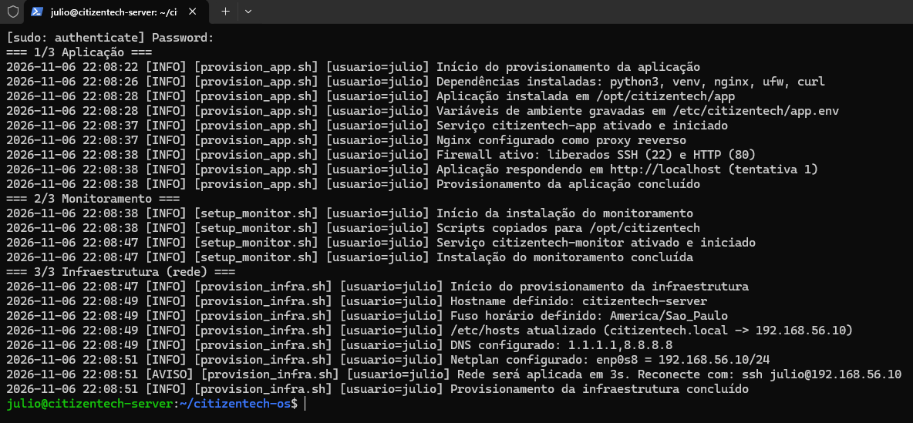

### 2. Verificação de rede, hostname e DNS
Hostname, fuso horário, IP fixo, resolução do domínio local, servidores DNS e conectividade.

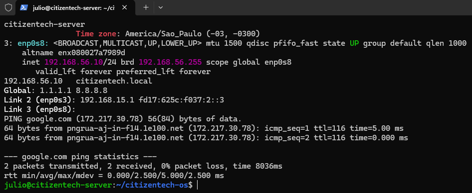

### 3. Aplicação no navegador
Aplicação acessada pelo Windows no endereço da VM.

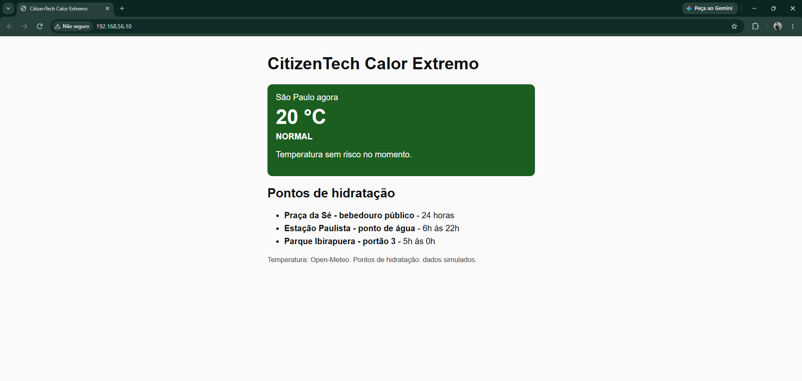

### 4. Serviços ativos
Aplicação, monitor e Nginx ativos e habilitados para iniciar com o sistema.

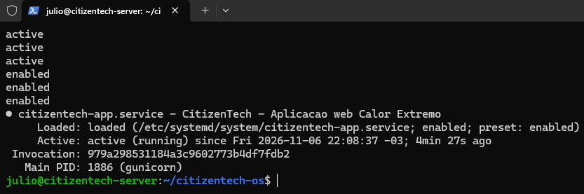

### 5. Monitor em execução
Serviço de monitoramento ativo, registrando CPU, memória e disco.

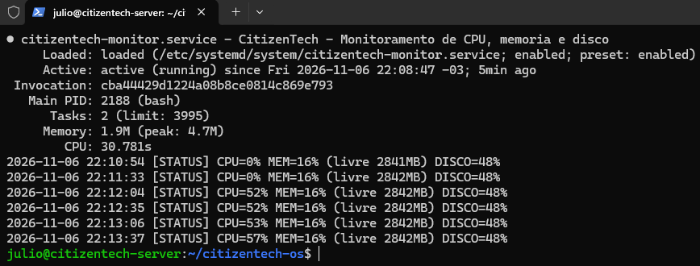

### 6. Alerta de CPU
Alertas de consumo elevado de CPU registrados durante picos de inicialização.

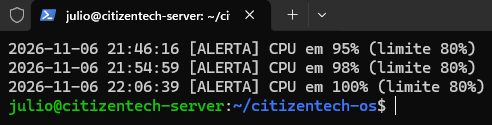

### 7. Alerta de disco
Arquivo de teste de 4 GB elevando o uso de disco para 86% e gerando alerta.

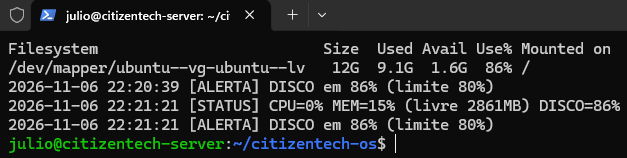

### 8. Recuperação após `kill -9`
Processo do monitor encerrado à força e reiniciado pelo systemd com novo PID.

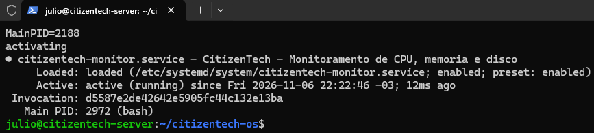

### 9. Falha e recuperação do Nginx
Nginx parado manualmente, falha detectada e serviço recuperado pelo monitor.

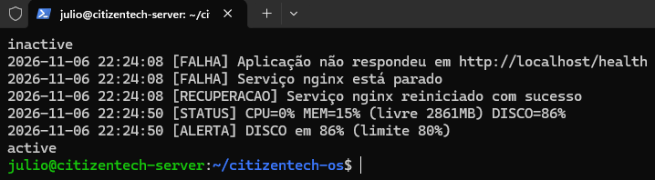

### 10. Start, stop e restart do monitor
Controle manual do serviço de monitoramento.

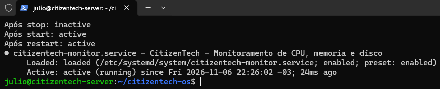

### 11. Serviços após reboot
Serviços ativos automaticamente após reinicialização da VM.

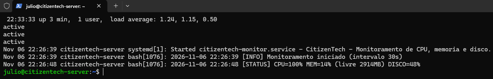

### 12. Falha controlada no log
Erro provocado de propósito e registrado no log de auditoria com linha e comando.

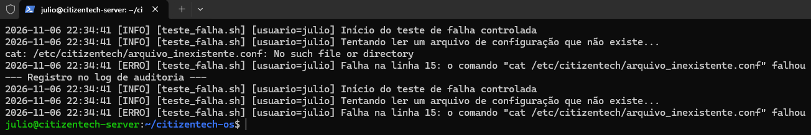

---

---

## Vídeo de demonstração

Link: _(adicionar link do YouTube)_

---

## Fontes de dados

- **Temperatura e umidade:** API pública [Open-Meteo](https://open-meteo.com)
- **Índice de calor:** fórmula da NOAA, a mesma usada nas outras partes da Refresca
- **Pontos Refresca:** dados simulados (comércios fictícios). Nenhum dado pessoal real é usado.

## Uso de IA

O registro do uso de IA como copiloto está em [`prompts.md`](prompts.md).